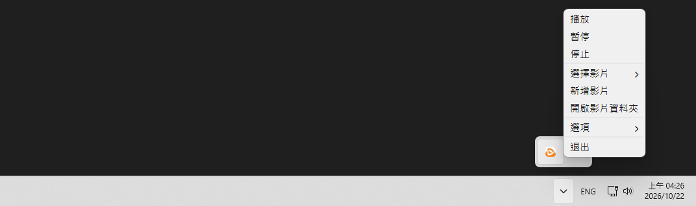

# BB 视频壁纸

**[繁體中文](README.md) | 简体中文 | [日本語](README.ja.md) | [한국어](README.ko.md) | [English](README.en.md)**

可以将视频作为壁纸播放，同时也是一款非常轻量的壁纸管理软件。  
将壁纸保存在一个文件夹中，以便随时切换。  

- 轻量（约 200MB）
- 记录最近使用的壁纸
- 可选择各种自动暂停时机（窗口最大化、屏幕关闭、未接通电源）
- 可选择开机自动启动

### 截图



# 下载

### 到 Releases 下载最新版

- [bb-video-wallpaper-setup.exe](https://github.com/BeefBB/bb-video-wallpaper/releases)

# 使用

1. 右键点击系统托盘图标，选择「添加视频」
2. 选择视频或图片
3. 之后可通过「选择视频」切换壁纸

也可以通过「打开视频文件夹」手动放入视频或图片，再从「选择视频」中选择。  

> 「清除记录」会清除最近使用记录并保留当前壁纸，不会删除文件。  

## 日志

遇到问题时，可查看 `%LOCALAPPDATA%\BB\BB Video Wallpaper\log\log.log`。  
日志记录操作信息、警告和错误，已捕获的异常包含完整错误堆栈。  

# 想自己编译？

## 需求

- [VLC](https://www.videolan.org/)

### 将 `VLC` 放在适当的位置

```text
bb-video-wallpaper/
 ├─ icon/
 │   └─ bb-video-wallpaper.ico
 ├─ lang/
 │   └─ ...
 ├─ VLC/
 │   ├─ plugins/
 │   ├─ libvlc.dll
 │   ├─ libvlccore.dll
 │   └─ ...
 ├─ bb-video-wallpaper.py
 ├─ bb_image_display.py
 ├─ config.py
 ├─ media_import.py
 ├─ media_preview.py
 ├─ playback.py
 ├─ screen_follow.py
 ├─ windows_integration.py
 ├─ thumbnails.py
 ├─ libvlc.dll
 └─ requirements.txt
```

## 运行

```bash
py -m venv .venv
.\.venv\Scripts\Activate.ps1
pip install -r requirements.txt
```

```bash
pyinstaller --noconfirm --onedir --noconsole --uac-admin --icon=icon/bb-video-wallpaper.ico --name="BB Video Wallpaper" --add-data "icon;icon" bb-video-wallpaper.py
```

打包后会生成在 `./dist`。  
然后将 `lang/`、`VLC/`、`libvlc.dll` 放在 `.exe` 旁边。  
目录结构如下：  

```text
Folder/
 ├─ _internal/
 │   └─ ...
 ├─ lang/
 │   └─ ...
 ├─ VLC/
 │   ├─ plugins/
 │   ├─ libvlc.dll
 │   ├─ libvlccore.dll
 │   └─ ...
 ├─ BB Video Wallpaper.exe
 └─ libvlc.dll
```

## 默认值

### config.json

名称 | 项目 | 默认值
--- | --- | ---
语言 | "language" | 缺少字段时: 安装语言 > 系统语言 > 繁体中文; 字段已存在但无效时: 繁体中文
窗口最大化时自动暂停 | "autoPauseIfFullscreen" | true
屏幕关闭时自动暂停 | "autoPauseIfScreenOff" | true
未接通电源时自动暂停 | "autoPauseIfOnBattery" | false
字体大小 | "fontSize" | 11 pt, 6-48
最近记录显示条数 | "recentDisplayCount" | 6 条, 0-20
最近使用记录 | "recentVideo" | [], 0-20 条
各屏幕壁纸 | "screenWallpapers" | {}
屏幕跟随关系 | "screenFollows" | {}

语言代码必须完全匹配 `zh-TW`, `zh-CN`, `ja-JP`, `ko-KR`, `en-US`; 例如系统语言为 `en-GB` 时不会自动对应 `en-US`

### 内部常量

名称 | 项目 | 默认值
--- | --- | ---
媒体文件夹 | MEDIA_DIR | `%LOCALAPPDATA%\BB\BB Video Wallpaper\video\`
单文件导入文件夹 | SINGLE_IMPORT_DIR | 媒体文件夹下的 `_imports/`
缩略图文件夹 | THUMBNAIL_DIR | `%LOCALAPPDATA%\BB\BB Video Wallpaper\thumbnails\`
日志文件 |  | `%LOCALAPPDATA%\BB\BB Video Wallpaper\log\log.log`
VLC 壁纸播放参数 |  | 关闭音频, 不显示视频标题, 重播参数 `--input-repeat=65535`
壁纸缩放方式 |  | 图片和视频均保持比例居中裁剪填满
启动时选择壁纸的顺序 |  | 该屏幕保存的壁纸 > 最近记录第一条 > 媒体列表第一项, 前两者要求文件存在
启动时延后最大化检测 | fullscreen_detection_timer | 10 s
自动暂停检查间隔 | check_auto_pause_timer | 0.5 s
壁纸重新挂载默认延迟 |  | 0.2 s
桌面未就绪时的重新挂载等待 |  | 2 s
壁纸重新挂载失败重试间隔 |  | 2 s
壁纸重新挂载失败重试上限 |  | 2 次, 含首次共 3 次
停止 VLC 时的唤醒间隔 |  | 0.05 s
启动时检查桌面就绪的间隔 |  | 1 s
通知显示时间 |  | 3 s
日志级别 |  | INFO
单个日志文件大小上限 |  | 2 MiB
旧日志保留份数 |  | 3 份
跟随屏幕定期同步间隔 | SYNC_INTERVAL_MS | 60 s
跟随屏幕同步误差容许值 | SYNC_TOLERANCE_MS | 0.5 s
启动时恢复跟随关系前的等待 | RESTORE_DELAY_MS | 3 s, 仅在有已保存的跟随关系时等待
首次显示预览的等待时间 | preview_timer | 0.5 s
离开选项后退出预览模式的延迟 | reset_timer | 1 s
预览图片最大宽度 |  | 300 px, 不含左右各 4 px 内边距, 屏幕空间不足时缩小
预览背景色 |  | #202020
预览内边距 |  | 4 px
预览与菜单间距 |  | 8 px, 优先放在左侧, 空间不足时改放右侧
加载图片失败时的替代图 |  | 300 x 169 px, 深灰色 (`Qt.GlobalColor.darkGray`)
缩略图宽度 |  | 300 px, 高度按媒体比例缩放
缩略图格式和质量 |  | JPEG 85
缩略图 VLC 参数 |  | 关闭硬件解码 (`--avcodec-hw=none`), 音频, 视频标题和 OSD, 启用 `--quiet`
视频信息解析超时 |  | 5 s
视频画面捕获超时 |  | 10 s
解析与捕获等待检查间隔 |  | 0.05 s
视频缩略图捕获画面 |  | 第一个解码画面
支持的视频扩展名 | SUPPORTED_VIDEO_EXTENSIONS | .mp4, .mkv, .webm, .mov, .avi
支持的图片扩展名 | SUPPORTED_IMAGE_EXTENSIONS | .jpg, .jpeg, .png, .bmp, .webp
导入时额外预留空间 | IMPORT_RESERVE_BYTES | 200 MiB
导入读取块大小 |  | SHA-256 计算和文件复制均为 1 MiB
最大化检测边界容许值 | FULLSCREEN_MARGIN | 4 px, 按屏幕工作区域判断
最大化检测排除的窗口标题 | WINDOW_TITLE_BLACKLIST | `""`, `default ime`, `msctfime ui`, `windows 輸入體驗`, `搜尋`, `search`, `開始`, `start`, `工作檢視`, `task view`
最大化检测排除的窗口类 | SHELL_CLASSES | `Progman`, `WorkerW`, `Shell_TrayWnd`, `Shell_SecondaryTrayWnd`
桌面挂载消息单次超时 |  | 1 s
开机自动启动 |  | 无既有任务时为 false, 实际状态取决于 Windows 计划任务是否存在, 启用后在登录时触发

# VLC

`bb-video-wallpaper-setup.exe` 内含经过精简的 **VLC 3.0.24**，仅保留 **BB 视频壁纸**播放视频所需的组件。  
VLC 是开源软件，相关版权和许可证信息请参阅 `安装目录/VLC/` 中的 VLC 许可证文件。  

# 许可证

BB 视频壁纸采用 MIT License。  
软件内含的 VLC 3.0.24 相关组件根据 VLC 所适用的许可证条款提供。  
