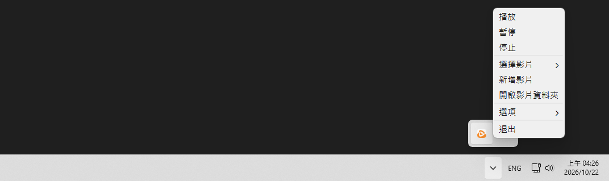

# BB 動画壁紙

**[繁體中文](README.md) | [简体中文](README.cn.md) | 日本語 | [English](README.en.md)**

壁紙として動画を再生できる、軽量な壁紙管理ソフトウェアです。  
壁紙を1つのフォルダに保存し、いつでも簡単に切り替えることができます。  

- 軽量（約200MB）
- 最近使った壁紙を記録
- 各種の自動一時停止条件を選択可能（ウィンドウの最大化、画面オフ、バッテリー駆動時）
- Windows 起動時の自動起動に対応

### スクリーンショット



# ダウンロード

### Releases から最新版をダウンロード

- [bb-video-wallpaper-setup.exe](https://github.com/BeefBB/bb-video-wallpaper/releases)

# 使い方

1. システムトレイのアイコンを右クリックし、「動画を追加」を選択
2. 動画または画像を選択
3. 以降は「動画を選択」から壁紙を切り替えられます

「動画フォルダーを開く」から動画や画像を手動で入れ、「動画を選択」から選ぶこともできます。  

> 「履歴をクリア」は現在の壁紙を残して最近使った履歴を消去します。ファイルは削除されません。  

## ログ

問題が発生した場合は、`%LOCALAPPDATA%\BB\BB Video Wallpaper\log\log.log` を確認してください。  
ログには操作情報、警告、エラーが記録され、捕捉された例外には完全なスタックトレースが含まれます。  

# 自分でビルドする場合

## 必要なもの

- [VLC](https://www.videolan.org/)

### `VLC` を適切な場所に配置

```text
bb-video-wallpaper/
 ├─ icon/
 │   └─ bb-video-wallpaper.ico
 ├─ lang/
 │   └─ ...
 ├─ VLC/
 │   ├─ plugins/
 │   ├─ libvlc.dll
 │   ├─ libvlccore.dll
 │   └─ ...
 ├─ bb-video-wallpaper.py
 ├─ config.py
 ├─ thumbnails.py
 ├─ libvlc.dll
 └─ requirements.txt
```

## 実行

```bash
py -m venv .venv
.\.venv\Scripts\Activate.ps1
pip install -r requirements.txt
```

```bash
pyinstaller --noconfirm --onedir --noconsole --uac-admin --icon=icon/bb-video-wallpaper.ico --name="BB Video Wallpaper" --add-data "icon;icon" bb-video-wallpaper.py
```

ビルド後のファイルは `./dist` に生成されます。  
その後、`lang/`、`VLC/`、`libvlc.dll` を `.exe` と同じ場所に配置してください。  
以下のような構成になります。  

```text
Folder/
 ├─ _internal/
 │   └─ ...
 ├─ lang/
 │   └─ ...
 ├─ VLC/
 │   ├─ plugins/
 │   ├─ libvlc.dll
 │   ├─ libvlccore.dll
 │   └─ ...
 ├─ BB Video Wallpaper.exe
 └─ libvlc.dll
```

# VLC

`bb-video-wallpaper-setup.exe` には、**BB 動画壁紙**での動画再生に必要なコンポーネントのみを残した、削減版の **VLC 3.0.24** が含まれています。  
VLC はオープンソースソフトウェアです。関連する著作権およびライセンス情報については、`インストール先/VLC/` にある VLC のライセンス文書をご確認ください。  

# ライセンス

BB 動画壁紙は MIT License を採用しています。  
ソフトウェアに含まれる VLC 3.0.24 の関連コンポーネントは、VLC に適用されるライセンス条件に従って提供されます。  
