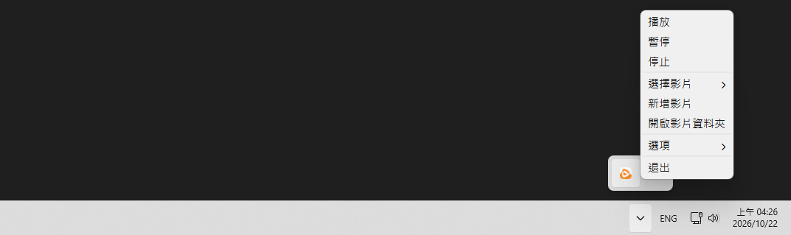

# BB 동영상 배경화면

**[繁體中文](README.md) | [简体中文](README.cn.md) | [日本語](README.ja.md) | 한국어 | [English](README.en.md)**

동영상을 바탕 화면 배경으로 재생할 수 있는 가벼운 배경화면 관리 프로그램입니다.  
배경화면을 한 폴더에 보관하여 언제든지 간편하게 전환할 수 있습니다.  

- 가벼운 용량 (약 200 MB)
- 최근 사용한 배경화면 기록
- 자동 일시 중지 조건 선택 (창 최대화, 화면 꺼짐, 배터리 사용)
- Windows 시작 시 자동 실행 옵션

### 스크린샷



# 다운로드

### Releases에서 최신 버전 다운로드

- [bb-video-wallpaper-setup.exe](https://github.com/BeefBB/bb-video-wallpaper/releases)

# 사용 방법

1. 시스템 트레이 아이콘을 마우스 오른쪽 버튼으로 클릭하고 "동영상 추가"를 선택합니다
2. 동영상이나 이미지를 선택합니다
3. 이후에는 "동영상 선택"에서 배경화면을 전환할 수 있습니다

"동영상 폴더 열기"로 동영상이나 이미지를 직접 추가한 다음, "동영상 선택"에서 선택할 수도 있습니다.  

> "최근 기록 지우기"는 현재 배경화면을 유지하면서 최근 사용 기록을 지웁니다. 파일은 삭제하지 않습니다.  

## 로그

문제가 발생하면 `%LOCALAPPDATA%\BB\BB Video Wallpaper\log\log.log`를 확인하세요.  
로그에는 작업 내역, 경고 및 오류가 기록되며, 처리된 예외에는 전체 스택 추적이 포함됩니다.  

# 직접 빌드하려면?

## 요구 사항

- [VLC](https://www.videolan.org/)

### `VLC`를 적절한 위치에 배치

```text
bb-video-wallpaper/
 ├─ icon/
 │   └─ bb-video-wallpaper.ico
 ├─ lang/
 │   └─ ...
 ├─ VLC/
 │   ├─ plugins/
 │   ├─ libvlc.dll
 │   ├─ libvlccore.dll
 │   └─ ...
 ├─ bb-video-wallpaper.py
 ├─ bb_image_display.py
 ├─ config.py
 ├─ media_import.py
 ├─ media_preview.py
 ├─ playback.py
 ├─ screen_follow.py
 ├─ windows_integration.py
 ├─ thumbnails.py
 ├─ libvlc.dll
 └─ requirements.txt
```

## 실행

```bash
py -m venv .venv
.\.venv\Scripts\Activate.ps1
pip install -r requirements.txt
```

```bash
pyinstaller --noconfirm --onedir --noconsole --uac-admin --icon=icon/bb-video-wallpaper.ico --name="BB Video Wallpaper" --add-data "icon;icon" bb-video-wallpaper.py
```

빌드 결과는 `./dist`에 생성됩니다.  
그런 다음 `lang/`, `VLC/`, `libvlc.dll`을 `.exe` 옆에 배치하세요.  
최종 폴더 구조는 다음과 같습니다:  

```text
Folder/
 ├─ _internal/
 │   └─ ...
 ├─ lang/
 │   └─ ...
 ├─ VLC/
 │   ├─ plugins/
 │   ├─ libvlc.dll
 │   ├─ libvlccore.dll
 │   └─ ...
 ├─ BB Video Wallpaper.exe
 └─ libvlc.dll
```

# VLC

`bb-video-wallpaper-setup.exe`에는 BB 동영상 배경화면의 동영상 재생에 필요한 구성 요소만 남긴 **VLC 3.0.24** 축소 버전이 포함되어 있습니다.  
VLC는 오픈 소스 소프트웨어입니다. 저작권 및 라이선스 정보는 `설치 폴더/VLC/`에 있는 VLC 라이선스 문서를 참조하세요.  

# 라이선스

BB 동영상 배경화면은 MIT License로 배포됩니다.  
포함된 VLC 3.0.24 구성 요소에는 해당 VLC 라이선스 조건이 적용됩니다.  
