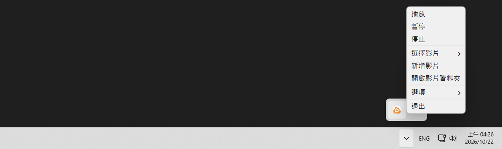

# BB 影片桌布

**繁體中文 | [简体中文](README.cn.md) | [日本語](README.ja.md) | [한국어](README.ko.md) | [English](README.en.md)**

能在桌布播放影片, 同時也是一個極輕量的桌布管理軟體  
將桌布保存在一個資料夾中, 以便隨時切換  

- 輕量 (~200MB)
- 記錄最近使用的桌布
- 可選各種自動暫停時機 (視窗最大化, 螢幕關閉, 沒插電)
- 可選開機自動啟動

### 截圖



# 下載

### 到 Releases 下載最新版

- [bb-video-wallpaper-setup.exe](https://github.com/BeefBB/bb-video-wallpaper/releases)

# 使用

1. 在系統匣圖示上按右鍵, 選擇 "新增影片"
2. 選取影片或圖片
3. 之後可從 "選擇影片" 切換桌布

也可以透過 "開啟影片資料夾" 手動放入影片或圖片, 再從 "選擇影片" 選取  

> "清除紀錄" 會清除最近使用紀錄並保留目前桌布, 不會刪除檔案  

## 日誌

遇到問題時, 可查看 `%LOCALAPPDATA%\BB\BB Video Wallpaper\log\log.log`,  
日誌記錄操作資訊, 警告與錯誤, 已捕捉的例外包含完整錯誤堆疊  

# 想自己編譯?

## 需求

- [VLC](https://www.videolan.org/)

### 把 `VLC` 放在適當位置

```
bb-video-wallpaper/
 ├─ icon/
 │   └─ bb-video-wallpaper.ico
 ├─ lang/
 │   └─ ...
 ├─ VLC/
 │   ├─ plugins/
 │   ├─ libvlc.dll
 │   ├─ libvlccore.dll
 │   └─ ...
 ├─ bb-video-wallpaper.py
 ├─ bb_image_display.py
 ├─ config.py
 ├─ media_import.py
 ├─ media_preview.py
 ├─ playback.py
 ├─ screen_follow.py
 ├─ windows_integration.py
 ├─ thumbnails.py
 ├─ libvlc.dll
 └─ requirements.txt
```

## 執行

```bash
py -m venv .venv
.\.venv\Scripts\Activate.ps1
pip install -r requirements.txt
```

```bash
pyinstaller --noconfirm --onedir --noconsole --uac-admin --icon=icon/bb-video-wallpaper.ico --name="BB Video Wallpaper" --add-data "icon;icon" bb-video-wallpaper.py
```

打包後會在 `./dist`,  
然後將 `lang/`, `VLC/`, `libvlc.dll` 放在 .exe 旁邊  
像是這樣:  

```
Folder/
 ├─ _internal/
 │   └─ ...
 ├─ lang/
 │   └─ ...
 ├─ VLC/
 │   ├─ plugins/
 │   ├─ libvlc.dll
 │   ├─ libvlccore.dll
 │   └─ ...
 ├─ BB Video Wallpaper.exe
 └─ libvlc.dll
```

## 預設值

### config.json

名稱                     | 項目                    | 預設值
---                      | ---                     | ---
語言                     | "language"              | 缺少欄位時: 安裝語言 > 系統語言 > 繁體中文; 已有欄位但無效時: 繁體中文
視窗最大化時自動暫停     | "autoPauseIfFullscreen" | true
螢幕關閉時自動暫停       | "autoPauseIfScreenOff"  | true
沒插電時自動暫停         | "autoPauseIfOnBattery"  | false
文字大小                 | "fontSize"              | 11 pt, 6-48
最近紀錄顯示筆數         | "recentDisplayCount"    | 6 筆, 0-20
預覽大小                 | "previewSize"           | 3 (普通), 1-5 對應 100-500 px
最近使用紀錄             | "recentVideo"           | [], 0-20
各螢幕桌布               | "screenWallpapers"      | {}
螢幕跟隨關係             | "screenFollows"         | {}

語言代碼須完全符合 `zh-TW`, `zh-CN`, `ja-JP`, `ko-KR`, `en-US`; 例如系統語言為 `en-GB` 時不會自動對應 `en-US`

### 內部常數

名稱                     | 項目                       | 預設值
---                      | ---                        | ---
媒體資料夾               | MEDIA_DIR                  | `%LOCALAPPDATA%\BB\BB Video Wallpaper\video\`
單檔匯入資料夾           | SINGLE_IMPORT_DIR          | 媒體資料夾下的 `_imports/`
縮圖資料夾               | THUMBNAIL_DIR              | `%LOCALAPPDATA%\BB\BB Video Wallpaper\thumbnails\`
日誌檔案                 |                            | `%LOCALAPPDATA%\BB\BB Video Wallpaper\log\log.log`
VLC 桌布播放參數         |                            | 關閉音訊, 不顯示影片標題, 重播參數 `--input-repeat=65535`
桌布縮放方式             |                            | 圖片與影片皆等比例置中裁切填滿
啟動時選擇桌布的順序     |                            | 該螢幕保存的桌布 > 最近紀錄第一筆 > 媒體清單第一筆, 前兩者須檔案存在
啟動時延後最大化偵測     | fullscreen_detection_timer | 10 s
自動暫停檢查間隔         | check_auto_pause_timer     | 0.5 s
桌布重掛預設延遲         |                            | 0.2 s
桌面未就緒時的重掛等待   |                            | 2 s
桌布重掛失敗重試間隔     |                            | 2 s
桌布重掛失敗重試上限     |                            | 2 次, 含首次共 3 次
停止 VLC 時的喚醒間隔    |                            | 0.05 s
啟動時檢查桌面就緒的間隔 |                            | 1 s
通知顯示時間             |                            | 3 s
日誌等級                 |                            | INFO
日誌單檔大小上限         |                            | 2 MiB
舊日誌保留份數           |                            | 3 份
跟隨螢幕定期同步間隔     | SYNC_INTERVAL_MS           | 60 s
跟隨螢幕同步誤差容許值   | SYNC_TOLERANCE_MS          | 0.5 s
啟動時還原跟隨關係前等待 | RESTORE_DELAY_MS           | 3 s , 有已保存的跟隨關係時才等待
首次顯示預覽的等待時間   | preview_timer              | 0.5 s
離開選項後退出預覽模式   | reset_timer                | 1 s
預覽圖片最長邊           |                            | `previewSize * 100` px, 不含左右各 4 px 內距, 螢幕空間不足時縮小
預覽背景色               |                            | #202020
預覽內距                 |                            | 4 px
預覽與選單間距           |                            | 8 px, 優先放左側, 空間不足時改放右側
載入圖片失敗時的替代圖   |                            | 寬 `previewSize * 100` px, 高依 16:9 四捨五入, 深灰色 (`Qt.GlobalColor.darkGray`)
縮圖 寬度                |                            | `previewSize * 100` px, 高度依媒體比例, 各尺寸按需產生並共存
縮圖 格式, 品質          |                            | JPEG 85
縮圖 VLC 參數            |                            | 關閉硬體解碼 (`--avcodec-hw=none`), 音訊, 影片標題與 OSD, 啟用 `--quiet`
影片資訊解析逾時         |                            | 5 s
影片畫面擷取逾時         |                            | 10 s
解析與擷取等待檢查間隔   |                            | 0.05 s
影片縮圖擷取畫面         |                            | 第一個解碼畫面
支援影片副檔名           | SUPPORTED_VIDEO_EXTENSIONS | .mp4, .mkv, .webm, .mov, .avi
支援圖片副檔名           | SUPPORTED_IMAGE_EXTENSIONS | .jpg, .jpeg, .png, .bmp, .webp
匯入時額外預留空間       | IMPORT_RESERVE_BYTES       | 200 MiB
匯入讀取區塊大小         |                            | SHA-256 計算與檔案複製皆為 1 MiB
最大化偵測邊界容許值     | FULLSCREEN_MARGIN          | 4 px, 以螢幕工作區域判定
最大化偵測排除視窗標題   | WINDOW_TITLE_BLACKLIST     | `""`, `default ime`, `msctfime ui`, `windows 輸入體驗`, `搜尋`, `search`, `開始`, `start`, `工作檢視`, `task view`
最大化偵測排除視窗類別   | SHELL_CLASSES              | `Progman`, `WorkerW`, `Shell_TrayWnd`, `Shell_SecondaryTrayWnd`
桌面掛載訊息單次逾時     |                            | 1 s
開機自動啟動             |                            | 無既有排程時為 false, 實際狀態依 Windows 工作排程是否存在, 啟用後於登入時觸發

# VLC

`bb-video-wallpaper-setup.exe` 內含經刪減的 **VLC 3.0.24**, 僅保留 BB 影片桌布 播放影片所需的元件  
VLC 為開源軟體, 相關著作權與授權資訊請參閱 `安裝目錄/VLC/` 中的 VLC 授權文件  

# 授權

BB 影片桌布 採用 MIT License  
軟體內含的 VLC 3.0.24 相關元件依 VLC 所適用的授權條款提供  
