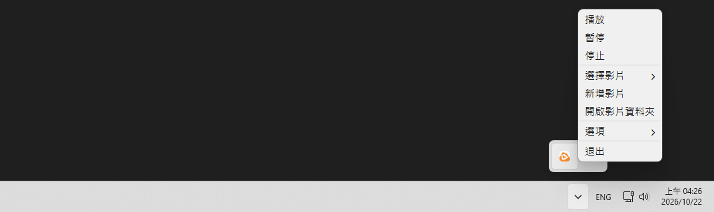

# BB Video Wallpaper

**[繁體中文](../README.md) | [简体中文](README.cn.md) | [日本語](README.ja.md) | [한국어](README.ko.md) | English**

Play videos as your desktop wallpaper while keeping it lightweight and simple to manage.  
Store your wallpapers in a single folder, making it easy to switch between them at any time.  

- Lightweight (~200 MB)
- Keep a history of recently used wallpapers
- Various automatic pause options (when a window is maximized, the screen is turned off, or the PC is running on battery)
- Optional launch on system startup

### Screenshot



# Download

### Download the latest version from Releases

- [bb-video-wallpaper-setup.exe](https://github.com/BeefBB/bb-video-wallpaper/releases)

# Usage

1. Right-click the system tray icon and choose "Add Video"
2. Select a video or image
3. Use "Select Video" to switch wallpapers afterward

You can also use "Open Video Folder" to add videos or images manually, then choose one from "Select Video".  

> "Clear History" clears recent history while keeping the current wallpaper. It does not delete any files.  

## Logs

If you encounter a problem, check `%LOCALAPPDATA%\BB\BB Video Wallpaper\log\log.log`.  
Logs record operations, warnings, and errors. Caught exceptions include full stack traces.  

# Want to Build It Yourself?

## Requirements

- [VLC](https://www.videolan.org/)

### Put `VLC` in the appropriate location

```text
bb-video-wallpaper/
 ├─ icon/
 │   └─ bb-video-wallpaper.ico
 ├─ lang/
 │   └─ ...
 ├─ VLC/
 │   ├─ plugins/
 │   ├─ libvlc.dll
 │   ├─ libvlccore.dll
 │   └─ ...
 ├─ bb-video-wallpaper.py
 ├─ bb_image_display.py
 ├─ bb_video_display.py
 ├─ config.py
 ├─ media_import.py
 ├─ media_preview.py
 ├─ playback.py
 ├─ screen_follow.py
 ├─ windows_integration.py
 ├─ thumbnails.py
 ├─ libvlc.dll
 └─ requirements.txt
```

## Run

```bash
py -m venv .venv
.\.venv\Scripts\Activate.ps1
pip install -r requirements.txt
```

```bash
pyinstaller --noconfirm --onedir --noconsole --uac-admin --icon=icon/bb-video-wallpaper.ico --name="BB Video Wallpaper" --add-data "icon;icon" bb-video-wallpaper.py
```

After building, the output will be in `./dist`.  
Then place `lang/`, `VLC/`, and `libvlc.dll` next to the `.exe`.  
The final folder structure should look like this:  

```text
Folder/
 ├─ _internal/
 │   └─ ...
 ├─ lang/
 │   └─ ...
 ├─ VLC/
 │   ├─ plugins/
 │   ├─ libvlc.dll
 │   ├─ libvlccore.dll
 │   └─ ...
 ├─ BB Video Wallpaper.exe
 └─ libvlc.dll
```

## Default Values

### config.json

Name | Item | Default
--- | --- | ---
Language | "language" | If the field is missing: installer language > system language > Traditional Chinese; if present but invalid: Traditional Chinese
Automatically pause when a window is maximized | "autoPauseIfFullscreen" | true
Automatically pause when the screen is off | "autoPauseIfScreenOff" | true
Automatically pause when on battery | "autoPauseIfOnBattery" | false
Font size | "fontSize" | 11 pt, 6-48
Number of recent entries to display | "recentDisplayCount" | 6 entries, 0-20
Preview size | "previewSize" | 3 (Normal), 1-5 maps to 100-500 px
Recently used media | "recentVideo" | [], 0-20 entries
Wallpaper for each monitor | "screenWallpapers" | {}
Monitor follow relationships | "screenFollows" | {}
Scaling modes per media file and monitor orientation | "scalingMode" | {}, uses fill when no setting exists
Background colors shared per media file | "backgroundColor" | {}, automatically calculated and saved in Fit mode

Language codes must exactly match `zh-TW`, `zh-CN`, `ja-JP`, `ko-KR`, or `en-US`; for example, the system language `en-GB` is not automatically mapped to `en-US`.

### Internal constants

Name | Item | Default
--- | --- | ---
Media folder | MEDIA_DIR | `%LOCALAPPDATA%\BB\BB Video Wallpaper\video\`
Single-file import folder | SINGLE_IMPORT_DIR | `_imports/` inside the media folder
Thumbnail folder | THUMBNAIL_DIR | `%LOCALAPPDATA%\BB\BB Video Wallpaper\thumbnails\`
Log file |  | `%LOCALAPPDATA%\BB\BB Video Wallpaper\log\log.log`
VLC wallpaper playback options |  | Audio disabled, video title hidden, repeat option `--input-repeat=65535`
Wallpaper scaling mode |  | fill (default), fit, or stretch, saved per media file and monitor orientation
Wallpaper selection order on startup |  | Saved wallpaper for the monitor > first recent entry > first media list entry; the file must exist for either of the first two choices
Delay before detecting maximized windows on startup | fullscreen_detection_timer | 10 s
Automatic pause check interval | check_auto_pause_timer | 0.5 s
Default wallpaper reattachment delay |  | 0.2 s
Reattachment wait when the desktop is not ready |  | 2 s
Retry interval after wallpaper reattachment fails |  | 2 s
Wallpaper reattachment retry limit |  | 2 retries, 3 attempts in total including the initial attempt
Wake interval when stopping VLC |  | 0.05 s
Desktop readiness check interval on startup |  | 1 s
Notification display duration |  | 3 s
Log level |  | INFO
Maximum size per log file |  | 2 MiB
Number of rotated logs to keep |  | 3 files
Periodic synchronization interval for following monitors | SYNC_INTERVAL_MS | 60 s
Playback synchronization tolerance for following monitors | SYNC_TOLERANCE_MS | 0.5 s
Delay before restoring monitor follow relationships on startup | RESTORE_DELAY_MS | 3 s, only when saved follow relationships exist
Delay before showing the first preview | preview_timer | 0.5 s
Delay before leaving preview mode after moving away | reset_timer | 1 s
Longest preview image edge |  | `previewSize * 100` px, excluding 4 px of padding on each side; shrinks when screen space is insufficient
Preview border background color |  | #202020; preview content uses the media file's background color
Preview padding |  | 4 px
Gap between the preview and menu |  | 8 px, preferably on the left; moves to the right if there is not enough space
Fallback when the loading image cannot be loaded |  | Width `previewSize * 100` px, height rounded to 16:9, dark gray (`Qt.GlobalColor.darkGray`)
Thumbnail width |  | `previewSize * 100` px, height follows the media aspect ratio; sizes are generated on demand and cached separately
Thumbnail format and quality |  | JPEG 85
VLC thumbnail options |  | Hardware decoding (`--avcodec-hw=none`), audio, video titles, and OSD disabled; `--quiet` enabled
Video metadata parsing timeout |  | 5 s
Video frame capture timeout |  | 10 s
Polling interval while parsing or capturing |  | 0.05 s
Frame used for video thumbnails |  | First decoded frame
Supported video file extensions | SUPPORTED_VIDEO_EXTENSIONS | .mp4, .mkv, .webm, .mov, .avi
Supported image file extensions | SUPPORTED_IMAGE_EXTENSIONS | .jpg, .jpeg, .png, .bmp, .webp
Additional disk space reserved for imports | IMPORT_RESERVE_BYTES | 200 MiB
Import read chunk size |  | 1 MiB for both SHA-256 calculation and file copying
Maximized window detection edge tolerance | FULLSCREEN_MARGIN | 4 px, based on the monitor work area
Window titles excluded from maximized window detection | WINDOW_TITLE_BLACKLIST | `""`, `default ime`, `msctfime ui`, `windows 輸入體驗`, `搜尋`, `search`, `開始`, `start`, `工作檢視`, `task view`
Window classes excluded from maximized window detection | SHELL_CLASSES | `Progman`, `WorkerW`, `Shell_TrayWnd`, `Shell_SecondaryTrayWnd`
Timeout per desktop attachment message |  | 1 s
Launch on system startup |  | false when no existing task is present; the actual state depends on whether the Windows scheduled task exists; when enabled, it runs at logon

# VLC

`bb-video-wallpaper-setup.exe` includes a reduced version of **VLC 3.0.24**, containing only the components required by BB Video Wallpaper for video playback.  
VLC is open-source software. For copyright and license information, please refer to the VLC license documents located in `Installation Directory/VLC/`.  

# License

BB Video Wallpaper is licensed under the MIT License.  
The included VLC 3.0.24 components are provided under the applicable VLC license terms.  
