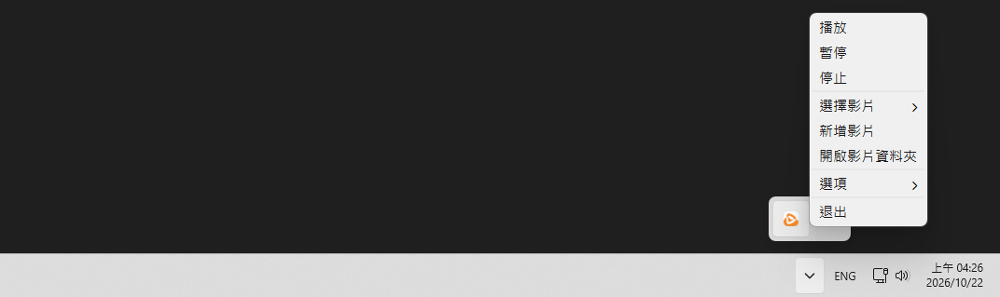

# BB 動画壁紙

**[繁體中文](../README.md) | [简体中文](README.cn.md) | 日本語 | [한국어](README.ko.md) | [English](README.en.md)**

壁紙として動画を再生できる、軽量な壁紙管理ソフトウェアです。  
壁紙を1つのフォルダに保存し、いつでも簡単に切り替えることができます。  

- 軽量（約200MB）
- 最近使った壁紙を記録
- 各種の自動一時停止条件を選択可能（ウィンドウの最大化、画面オフ、バッテリー駆動時）
- Windows 起動時の自動起動に対応

### スクリーンショット



# ダウンロード

### Releases から最新版をダウンロード

- [bb-video-wallpaper-setup.exe](https://github.com/BeefBB/bb-video-wallpaper/releases)

# 使い方

1. システムトレイのアイコンを右クリックし、「動画を追加」を選択
2. 動画または画像を選択
3. 以降は「動画を選択」から壁紙を切り替えられます

「動画フォルダーを開く」から動画や画像を手動で入れ、「動画を選択」から選ぶこともできます。  

> 「履歴をクリア」は現在の壁紙を残して最近の使用履歴を消去します。ファイルは削除されません。  

## ログ

問題が発生した場合は、`%LOCALAPPDATA%\BB\BB Video Wallpaper\log\log.log` を確認してください。  
ログには操作情報、警告、エラーが記録され、捕捉された例外には完全なスタックトレースが含まれます。  

# 自分でビルドする場合

## 必要なもの

- [VLC](https://www.videolan.org/)

### `VLC` を適切な場所に配置

```text
bb-video-wallpaper/
 ├─ icon/
 │   └─ bb-video-wallpaper.ico
 ├─ lang/
 │   └─ ...
 ├─ VLC/
 │   ├─ plugins/
 │   ├─ libvlc.dll
 │   ├─ libvlccore.dll
 │   └─ ...
 ├─ bb-video-wallpaper.py
 ├─ bb_image_display.py
 ├─ config.py
 ├─ media_import.py
 ├─ media_preview.py
 ├─ playback.py
 ├─ screen_follow.py
 ├─ windows_integration.py
 ├─ thumbnails.py
 ├─ libvlc.dll
 └─ requirements.txt
```

## 実行

```bash
py -m venv .venv
.\.venv\Scripts\Activate.ps1
pip install -r requirements.txt
```

```bash
pyinstaller --noconfirm --onedir --noconsole --uac-admin --icon=icon/bb-video-wallpaper.ico --name="BB Video Wallpaper" --add-data "icon;icon" bb-video-wallpaper.py
```

ビルド後のファイルは `./dist` に生成されます。  
その後、`lang/`、`VLC/`、`libvlc.dll` を `.exe` と同じ場所に配置してください。  
以下のような構成になります。  

```text
Folder/
 ├─ _internal/
 │   └─ ...
 ├─ lang/
 │   └─ ...
 ├─ VLC/
 │   ├─ plugins/
 │   ├─ libvlc.dll
 │   ├─ libvlccore.dll
 │   └─ ...
 ├─ BB Video Wallpaper.exe
 └─ libvlc.dll
```

## デフォルト値

### config.json

名前 | 項目 | デフォルト値
--- | --- | ---
言語 | "language" | フィールドがない場合: インストール時の言語 > システム言語 > 繁体字中国語; フィールドが存在しても無効な場合: 繁体字中国語
ウィンドウ最大化時に自動一時停止 | "autoPauseIfFullscreen" | true
画面オフ時に自動一時停止 | "autoPauseIfScreenOff" | true
バッテリー駆動時に自動一時停止 | "autoPauseIfOnBattery" | false
フォントサイズ | "fontSize" | 11 pt, 6-48
最近の使用履歴の表示件数 | "recentDisplayCount" | 6 件, 0-20
プレビューサイズ | "previewSize" | 3 (標準), 1-5 は 100-500 px に対応
最近の使用履歴 | "recentVideo" | [], 0-20 件
各モニターの壁紙 | "screenWallpapers" | {}
モニターの追従関係 | "screenFollows" | {}

言語コードは `zh-TW`, `zh-CN`, `ja-JP`, `ko-KR`, `en-US` のいずれかと完全に一致する必要があります。例えば、システム言語が `en-GB` の場合、`en-US` には自動的に対応付けられません。

### 内部定数

名前 | 項目 | デフォルト値
--- | --- | ---
メディアフォルダー | MEDIA_DIR | `%LOCALAPPDATA%\BB\BB Video Wallpaper\video\`
単一ファイルのインポート先フォルダー | SINGLE_IMPORT_DIR | メディアフォルダー内の `_imports/`
サムネイルフォルダー | THUMBNAIL_DIR | `%LOCALAPPDATA%\BB\BB Video Wallpaper\thumbnails\`
ログファイル |  | `%LOCALAPPDATA%\BB\BB Video Wallpaper\log\log.log`
VLC の壁紙再生オプション |  | 音声無効, 動画タイトル非表示, リピート設定 `--input-repeat=65535`
壁紙の拡大縮小方式 |  | 画像・動画ともに縦横比を維持し、中央で切り抜いて画面全体を埋める
起動時の壁紙選択順序 |  | そのモニターに保存された壁紙 > 最近の使用履歴の先頭 > メディア一覧の先頭; 保存された壁紙と履歴の候補は、ファイルが存在する場合のみ使用
起動時の最大化検出開始までの待機時間 | fullscreen_detection_timer | 10 s
自動一時停止の確認間隔 | check_auto_pause_timer | 0.5 s
壁紙の再アタッチのデフォルト遅延 |  | 0.2 s
デスクトップが未準備の場合の再アタッチ待機時間 |  | 2 s
壁紙の再アタッチ失敗時の再試行間隔 |  | 2 s
壁紙の再アタッチ失敗時の再試行上限 |  | 再試行 2 回, 初回を含めて計 3 回
VLC 停止時のウェイクアップ間隔 |  | 0.05 s
起動時のデスクトップ準備確認間隔 |  | 1 s
通知の表示時間 |  | 3 s
ログレベル |  | INFO
ログファイルごとの最大サイズ |  | 2 MiB
古いログの保持数 |  | 3 ファイル
追従モニターの定期同期間隔 | SYNC_INTERVAL_MS | 60 s
追従モニターの同期誤差許容値 | SYNC_TOLERANCE_MS | 0.5 s
起動時に追従関係を復元するまでの待機時間 | RESTORE_DELAY_MS | 3 s, 保存済みの追従関係がある場合のみ待機
初回プレビュー表示までの待機時間 | preview_timer | 0.5 s
項目から離れた後にプレビューモードを終了するまでの時間 | reset_timer | 1 s
プレビュー画像の最長辺 |  | `previewSize * 100` px, 左右それぞれ 4 px の内側余白を除く; 画面の空き領域が足りない場合は縮小
プレビューの背景色 |  | #202020
プレビューの内側余白 |  | 4 px
プレビューとメニューの間隔 |  | 8 px, 左側を優先し、空き領域が足りない場合は右側に表示
読み込み中表示用の画像を読み込めない場合の代替画像 |  | 幅 `previewSize * 100` px, 高さは 16:9 で丸める, ダークグレー (`Qt.GlobalColor.darkGray`)
サムネイルの幅 |  | `previewSize * 100` px, 高さはメディアの縦横比に応じて調整; 必要なサイズのみ生成して個別にキャッシュ
サムネイルの形式と品質 |  | JPEG 85
サムネイル用 VLC オプション |  | ハードウェアデコード (`--avcodec-hw=none`), 音声, 動画タイトル, OSD を無効化し、`--quiet` を有効化
動画情報の解析タイムアウト |  | 5 s
動画フレームの取得タイムアウト |  | 10 s
解析・取得待機中の確認間隔 |  | 0.05 s
動画サムネイルに使用するフレーム |  | 最初にデコードされたフレーム
対応する動画の拡張子 | SUPPORTED_VIDEO_EXTENSIONS | .mp4, .mkv, .webm, .mov, .avi
対応する画像の拡張子 | SUPPORTED_IMAGE_EXTENSIONS | .jpg, .jpeg, .png, .bmp, .webp
インポート時に追加で確保する空き容量 | IMPORT_RESERVE_BYTES | 200 MiB
インポート時の読み取りブロックサイズ |  | SHA-256 計算・ファイルコピーともに 1 MiB
最大化検出時の境界許容値 | FULLSCREEN_MARGIN | 4 px, モニターの作業領域を基準に判定
最大化検出から除外するウィンドウタイトル | WINDOW_TITLE_BLACKLIST | `""`, `default ime`, `msctfime ui`, `windows 輸入體驗`, `搜尋`, `search`, `開始`, `start`, `工作檢視`, `task view`
最大化検出から除外するウィンドウクラス | SHELL_CLASSES | `Progman`, `WorkerW`, `Shell_TrayWnd`, `Shell_SecondaryTrayWnd`
デスクトップへのアタッチメッセージごとのタイムアウト |  | 1 s
Windows 起動時の自動起動 |  | 既存タスクがなければ false; 実際の状態は Windows のスケジュール済みタスクの有無による; 有効時はログオン時に実行

# VLC

`bb-video-wallpaper-setup.exe` には、**BB 動画壁紙**での動画再生に必要なコンポーネントのみを残した、削減版の **VLC 3.0.24** が含まれています。  
VLC はオープンソースソフトウェアです。関連する著作権およびライセンス情報については、`インストール先/VLC/` にある VLC のライセンス文書をご確認ください。  

# ライセンス

BB 動画壁紙は MIT License を採用しています。  
ソフトウェアに含まれる VLC 3.0.24 の関連コンポーネントは、VLC に適用されるライセンス条件に従って提供されます。  
